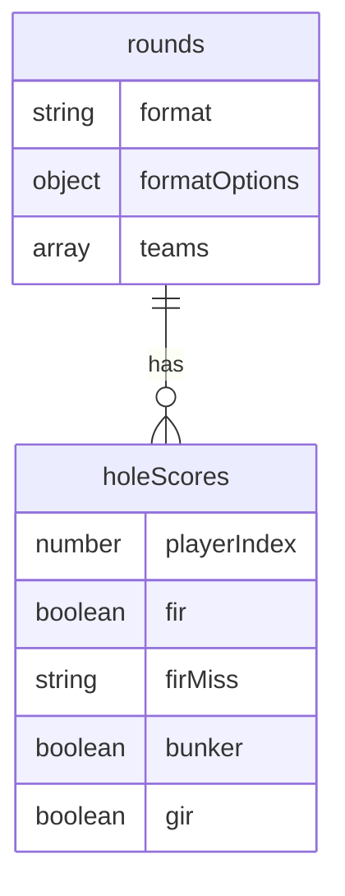

# Round setup and score entry — final study companion (APP-807)

Approved by Eric on decision cards, 24 Nov 2026: setup A, players A, handicap table in setup and in the round, Sixes and Texas Scramble with their data model, and score entry round 3 with its data model.

- Canvas: [Fairway — Rounds & stats](https://claude.ai/artifact/Jgn4oew8xuPNXr9Sg869aj), page `APP-807 Ronde instellen & scoren`. Rounds 1–3 and the alternatives that were not chosen stay on the canvas.
- Final artboard source: [`round-setup-scoring_final/`](round-setup-scoring_final/). Build from this file; the artboards are the visual reference.
- Phone only. The web round screens were retired in APP-235 ([ADR 0001](../../docs/adr/0001-the-phone-plays-rounds-and-the-web-authors-courses.md)).
- Builds on [Match play and skins](match-play_final.md) (APP-148): its format list, net/gross option and standing boxes stay as approved there, but the format picker becomes the tile grid below.

| Issue | Part | Artboard | Tier |
| --- | --- | --- | --- |
| APP-808 | Setup: holes, tee and format as tiles | `RS-SetupA.dc.html` | med |
| APP-809 | Setup: one row per player, edit sheet | `RS-Players.dc.html` (left two phones) | low |
| APP-812 | Handicap table sheet | `RS-Hcp.dc.html` | med |
| APP-813 | Score entry (owner expanded, flight below) | `RS-ScoreA3.dc.html` | high (schema) |
| APP-148, APP-810, APP-811 | Match play, skins, Sixes, Texas Scramble | `RS-Formats.dc.html`, `match-play_final/` | high (schema) |

## 1. Round setup (APP-808)

Order: Holes, Tee, Spelvorm, Spelers, then the primary button `Afslaan` (simulation: existing label).

- **Holes**: one tile per detected loop in a 2-column grid. Tile: title (`Holes 1–9`, the loop label) and secondary line `Par 36`. Selected = filled `accentFill`, text `onAccent`. Tapping a selected loop a second time plays it twice: secondary shows `Par 36 · ×2`; a third tap deselects (existing `toggleLoopPick`). No checkmarks anywhere. Footer as today (`18 holes · par 72`, incomplete holes message, hint).
- **Tee**: horizontal scrolling row of chips: colour dot (outlined so white shows), name, length in the user's unit (`5.720 m`). Selected chip filled. Course rating and slope move to the handicap table sheet header; keep them in the chip's accessibility label.
- **Spelvorm**: 2×3 tile grid in this order: Stableford (`Punten per hole`), Strokeplay (`Totaal slagen`), Matchplay (`2 spelers`), Skins (`2–4 spelers`), Zessen (`Precies 3 spelers`), Texas Scramble (`Teams · 2–4 spelers`). A format that doesn't fit the player count: dashed outline, muted text, not selectable; the footer says why (`Matchplay: alleen met precies 2 spelers. Je hebt er nu 3.`). If players change so the chosen format no longer fits, fall back to Stableford and show the reason. Format options sections (Matchplay, Skins, Zessen, Teams) appear under the grid when that format is chosen.
- Tiles and chips are `radio` (accessibilityRole radio, checked state), minimum 44 pt high.

## 2. Players (APP-809)

- Section `Spelers`: one row per player, owner first. Row: initial avatar (accentDim circle), name with secondary `Jij · HCP 12,4` / `HCP 17,1` / `Geen handicap · bruto`, trailing `speelt 19` and a chevron. Last row `Speler toevoegen` (plus icon, accent). Max 4 players as today.
- Tapping a row (or Add) opens a sheet `Speler` (Annuleren / Klaar): fields Naam and Handicap (decimal keyboard), footer `Speelt 19 van tee Geel. Leeg laten = geen handicap (bruto).`, a destructive `Speler verwijderen` button (guests only). Swipe-to-delete on guest rows as a shortcut.
- No handicap means gross (Eric, 24 Nov 2026): the player gets no strokes, plays off 0 in every format, and has no `speelt` value. It no longer counts as 54.
- The owner's row edits only the handicap for this round (name comes from the account).
- Footer under the section: `Speelhandicap van tee Geel, 18 holes.` plus the link `Slagen per hole ›` (opens §3).

## 3. Handicap table (APP-812)

- Sheet `Slagen per hole`, subtitle `Tee Geel · 18 holes`, `Klaar`. Reached from setup (link under Spelers) and in the round from the scorecard header and the Play menu.
- Table: Hole, Par, HCP (stroke index), then one column per player headed by name and playing handicap. A cell shows one `●` per extra stroke on that hole (none = empty); accessibility label `Piet: 1 slag`. In the round the current hole row is highlighted (`accentDim`, bold).
- Footer: `● = één slag extra op die hole. Stableford en netto scores rekenen hiermee.`
- Allocation from `strokesPerHole` in `@fairway/core/scoring`; a course without stroke indexes shows `Deze baan heeft geen handicapvolgorde per hole.` instead of the table.

## 4. Score entry (APP-813), round 3

Sheet with the hole header: `Annuleren` · `Hole 7` (22 pt bold) over `Par 4 · HCP 3 · 352 m` · `Opslaan` (iOS keeps the native toolbar button).

**Owner card** (surface, radius 24):
- Head: avatar, name, badge with the result relative to par (`Bogey · +1`; Stableford adds points: `Dubbel bogey · 1 pt`).
- Hero: score as a 72 pt number between round `−` and `+` buttons (52 pt). Starts at par when the hole has no score yet. Below it quick pills `par−1 … par+3`, the selected one filled. Picked up: long-press the number or the `⋯` in the menu (`Opgeraapt`), number shows `–`.
- `AFSLAG` (par 4 and 5 only): a fairway in three bands: `Links` (rough grey, left rounded), `Fairway` (accentDim, wider, flag icon), `Rechts` (rough grey, right rounded). Selected fairway = `accentFill`; selected miss = filled `text` colour. Tapping the selected band again clears it.
- Tiles row: `PUTTS` (− value +, starts empty, first + gives 2), `BUNKER` (toggle `Nee`/`Ja`, sand colour `#c9a35a` with `#1d1608` text when on), `STRAF` (− value +, 0).
- Green in regulation is no longer asked: on save, when putts are known, `gir = strokes − putts ≤ par − 2`; picked up = no GIR.

**Flight** (label `FLIGHT`, one list): a row per other player: avatar, name, secondary `+1 slag · netto 4` (Stableford `· 2 pt`), and round score buttons `par−1 … par+2` plus `⋯` (other score or picked up). One tap per player. Format standing boxes from APP-148 (match, skins) and Sixes sit between the hole header and the owner card.

Four players fit without scrolling on a 6.1" phone; on iPhone SE the flight may scroll under a fixed owner card.

## 5. Formats (APP-148, APP-810, APP-811)

- **Zessen**: exactly 3 players. Section `Zessen`: `Score: Netto | Bruto`, footer `Elke hole verdeelt 6 punten: 4 · 2 · 0. Gelijk voor de beste: 3 · 3 · 0. Gelijk voor de tweede: 4 · 1 · 1. Alle drie gelijk: 2 · 2 · 2. Netto telt ieders eigen handicapslagen.` Picked up ranks last. Score sheet standing box `Eric 18 · Piet 12 · Jan 6` / `Na 6 holes · …`, result box after all three have strokes (`Eric 4 · Piet 1 · Jan 1`).
- **Texas Scramble**: 2–4 players. Section `Teams`: `1 team | 2 teams`, `Score: Netto | Bruto`; a card per team with player chips, tap a chip to move the player to the other team; header shows `speelt {n}`. Team handicap (WHS allowances): 2 players 35% low + 15% high; 3 players 30/20/10%; 4 players 25/20/15/10%, rounded. Footer `… Een scramble telt niet mee voor je handicap en statistieken.` The score sheet shows one row per team (team name, members underneath) with the flight-row buttons; the owner card's stats are hidden.

## Data model (approved 24 Nov 2026)

`rounds` (changed):

| Field | Type | Required | Meaning |
| --- | --- | --- | --- |
| `format` (changed) | `roundFormat`: + `"match"`, `"skins"`, `"sixes"`, `"scramble"` | yes | Game format |
| `formatOptions` (new) | `{ scoring: "net" \| "gross"; carryOver?: boolean }` | no | Absent = net, carry-over on (APP-148) |
| `teams` (new) | `array({ playerIndexes: array(number) })` | no | Scramble only: 1 or 2 teams |

`holeScores` (changed):

| Field | Type | Required | Meaning |
| --- | --- | --- | --- |
| `playerIndex` (meaning widened) | `number` | yes | Scramble: the team index (team 0 holds the owner) |
| `firMiss` (new) | `"left" \| "right"` | no | Tee shot missed left or right; only when `fir` is false |
| `bunker` (new) | `boolean` | no | Was in a bunker on this hole (sand saves) |

- Derived, never stored: standings (match, skins, Sixes), team handicaps, GIR from strokes and putts.
- Existing data: untouched, no migration or backfill. Older scores have no `firMiss` or `bunker`.
- Stats: scramble rounds are excluded from the differential and personal stats. Sixes, match and skins count as normal (strokes per player). Fairway-miss stats use `firMiss` where present.
- Export includes the new fields; account deletion is unchanged (no new table).
- Installed builds: an older build must not crash on an unknown format or field. Check the installed builds' handling before merge; new formats can only be started from a build that knows them.

## Copy (English)

Holes · Tee · Format · Players · Add player · Plays {n} · No handicap · gross · Remove player · Strokes per hole · Sixes · Texas Scramble · Teams · 1 team · 2 teams · Net · Gross · Tee shot · Left · Fairway · Right · Putts · Bunker · Penalties · Flight · Picked up · "A scramble doesn't count toward your handicap or stats."

## Open runtime questions

1. iPhone SE: does the owner card stay fixed while the flight scrolls, or does the whole sheet scroll? Decide on device.
2. Live Activity: no change.

## Verify

iOS simulator, light and dark, iPhone 17 and SE: setup with 1, 2, 3 and 4 players (format tiles enable and disable), edit and remove a guest, the handicap table from setup and from the round, a 4-player hole scored with one tap per guest, owner tee shot / putts / bunker / penalties saved and shown again on reopening, a Sixes round with ties, a two-team scramble.
